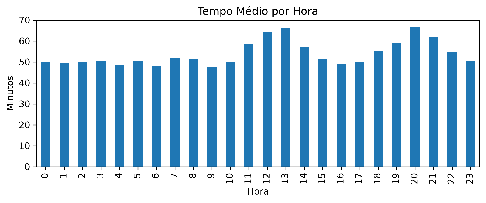

# NeuroStartup - Previsão de Tempo de Entrega (RangoJá)

## Integrantes

- Ana Carolina Sampaio dos Santos – RA 1680952
- Marcus Vinicius Ladeia Correa – RA 1515134

---

## Problema de Negócio

A empresa RangoJá deseja prever o tempo de entrega dos pedidos para fornecer estimativas mais precisas aos clientes.

Atualmente os clientes recebem previsões pouco precisas, gerando reclamações e insatisfação.

---

## Dados Utilizados

O conjunto possui 3000 entregas simuladas contendo:

- distância da entrega
- horário do pedido
- chuva
- fila de pedidos
- complexidade do prato

### Variável alvo

- tempo de entrega em minutos

---

## Análise Exploratória

### Tempo médio por hora



### Conclusão

Os maiores tempos de entrega acontecem próximos ao horário do almoço (12h–13h) e jantar (20h), indicando períodos de pico de demanda.

---

## Modelos Testados

| Arquitetura | Erro Médio (MAE) |
|------------|------------------|
| (8,) | 3.98 |
| (32,) | 2.55 |
| (64,32) | 3.12 |

O melhor modelo foi a arquitetura **(32,)**.

---

## Resultado Final

### Baseline Linear

```text
4,5 minutos
```

### Rede Neural

```text
2,5 minutos
```

### Comparação

A rede neural reduziu o erro médio de previsão em aproximadamente **44%** quando comparada ao modelo linear utilizado como baseline.

### Frase de Negócio

O novo modelo permite estimativas significativamente mais precisas de entrega, reduzindo o erro médio de previsão de 4,5 para 2,5 minutos e melhorando a experiência dos clientes.

---

## Arquitetura da Solução

### Variáveis de Entrada

- Distância (km)
- Hora do pedido
- Chuva (sim/não)
- Pedidos na fila
- Complexidade do prato

### Saída

- Tempo previsto de entrega (em minutos)

### Modelo

Rede Neural Multilayer Perceptron (MLP)

```python
MLPRegressor(hidden_layer_sizes=(32,))
```

---

## Produto

O modelo foi transformado em um pequeno sistema de previsão.

### Exemplo

```python
estimar_entrega(
    distancia_km=8,
    hora=12,
    chovendo=True,
    pedidos_na_fila=6,
    complexidade_prato=3
)
```

### Saída

```text
Seu pedido chega em aproximadamente 91 minutos
```

---

## Experimentos

Os experimentos realizados foram registrados em:

```text
experimentos.csv
```

Isso permite:

- rastreabilidade
- comparação entre modelos
- reprodutibilidade dos resultados

---

## Modelo Salvo

O modelo treinado foi salvo em:

```text
modelo_entregas.joblib
```

Isso permite reutilização sem necessidade de novo treinamento.

---

## Estrutura do Projeto

```text
neurostartup-rangoja/
│
├── README.md
├── MODEL_CARD.md
├── requirements.txt
├── experimentos.csv
├── modelo_entregas.joblib
├── neurostartup_rangoja.ipynb
│
├── imagens/
│   ├── grafico_horarios.png
│   ├── curva_treinamento.png
│   └── interface.png
│
└── dados/
    └── entregas.csv
```

---

## Como Executar

### 1. Clonar o repositório

```bash
git clone URL_DO_REPOSITORIO
```

### 2. Instalar as dependências

```bash
pip install -r requirements.txt
```

### 3. Abrir o notebook

```bash
jupyter notebook
```

Executar:

```text
neurostartup_rangoja.ipynb
```

---

## Tecnologias Utilizadas

- Python
- NumPy
- Pandas
- Matplotlib
- Scikit-Learn
- Joblib
- Jupyter Notebook

---

## Limitações

O modelo foi treinado com dados sintéticos e não considera:

- trânsito em tempo real
- acidentes
- eventos climáticos extremos
- obras nas vias

Para uso real seria necessário treinamento com dados reais da operação.

---

## Uso de Inteligência Artificial

Foi utilizada Inteligência Artificial generativa para apoio na:

- organização do projeto
- revisão de código
- documentação
- correção de erros

Todo o código foi revisado e compreendido pelos integrantes antes da entrega.

---

## Autor

Projeto desenvolvido para a disciplina:

**Inteligência Artificial e Machine Learning**

FMU – Ciência da Computação / Engenharia da Computação

Professor: **Hercules Ramos**